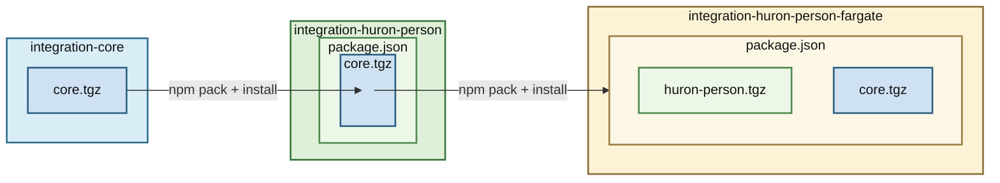

# integration-workspace-skills (BU → Huron person integration)

Shared Copilot skills repository for the BU → Huron person integration workspace.

## Purpose

This repository stores reusable skills that apply across multiple independent package repositories in this workspace.

The package repositories remain independently versioned and deployed:
- `integration-core`
- `integration-huron-person`
- `integration-huron-person-fargate`

### Overview of Repository Relationships:
- `integration-core`: Foundational utilities and shared logic for integration work. This comprises mainly interfaces and general use code for basic operations like S3 access, API clients, hash-based delta calculation, etc.
- `integration-huron-person`: Implements the core synchronization logic for Boston University → Huron person records. This comprises the main data mapping, and specific source/target business logic.
- `integration-huron-person-fargate`: AWS CDK infrastructure and serverless implementation for deploying the `integration-huron-person` project. This orchestrates a three-phase streaming delta synchronization pipeline using Lambda, ECS Fargate, S3, and SQS. Also primary among the orchestration is the implementation of parallel processing to speed up both the data acquistion from BU, and the pushing of mapped records into Huron.




## Layout

```text
integration-workspace-skills/
  skills/
    <skill-name>/
      SKILL.md
```

`chat.agentSkillsLocations` must point to the parent directory that contains the individual skill folders.

## VS Code Setup
*NOTE: The following assumes a VS Code development environment - adapt as needed for other editors.*
 
To enable Copilot skill discovery in VS Code, configure the `chat.agentSkillsLocations` setting in your [**`.code-workspace`** file](https://code.visualstudio.com/docs/editing/workspaces/workspaces#_workspace-settings).

Important: In [**multi-root**](https://code.visualstudio.com/docs/editing/workspaces/workspaces#_multiroot-workspaces) `.code-workspace` configurations, `chat.agentSkillsLocations` paths are resolved from each workspace root folder, not from the `.code-workspace` file path itself.

Recommended setting:

```json
"chat.agentSkillsLocations": {
  "../integration-workspace-skills/skills": true
}
```

## Example Workspace: Core Only

```json
{
  "folders": [
    {
      "path": "integration-workspace-skills",
      "name": "skills"
    },
    {
      "path": ".copilot/memories",
      "name": "workspace-memories"
    },
    {
      "path": "integration-core",
      "name": "core"
    }
  ],
  "settings": {
    "chat.tools.terminal.autoApprove": {
      "npm test": true
    },
    "chat.agentSkillsLocations": {
      "../integration-workspace-skills/skills": true
    }
  }
}
```

## Example Workspace: Core + Person + Fargate

```json
{
  "folders": [
    {
      "path": "integration-workspace-skills",
      "name": "skills"
    },
    {
      "path": ".copilot/memories",
      "name": "workspace-memories"
    },
    {
      "path": "integration-core",
      "name": "core"
    },
    {
      "path": "integration-huron-person",
      "name": "huron-person"
    },
    {
      "path": "integration-huron-person-fargate",
      "name": "huron-person-fargate"
    }
  ],
  "settings": {
    "chat.tools.terminal.autoApprove": {
      "npm test": true
    },
    "chat.agentSkillsLocations": {
      "../integration-workspace-skills/skills": true
    }
  }
}
```

## Workspace-Scoped Memory Files

The `.copilot/memories/` directory (displayed as "workspace-memories" in the workspace) stores workspace-scoped Copilot memory files that apply to all integration projects.

**Purpose**: Contains coding preferences, task verification protocols, and workflow requirements that should be consistently applied across all projects (core, huron-person, fargate, dashboard, file-drop, etc.).

**Key file**: `task-verification-protocol.md` - Defines requirements for build verification, test execution, and completion reporting on all code implementation tasks.

**Discovery**: VS Code Copilot automatically loads memory files from this directory when included as a workspace folder in your `.code-workspace` file.

**Location**: The `.copilot/memories/` directory exists at the workspace root level (parallel to project folders), not within individual project repositories. This ensures workspace-wide conventions are version-controlled separately from project-specific code.

**Scope**: These memory files complement (not replace) the skills in this repository. Skills define domain-specific technical patterns, while memory files define workflow and verification requirements.

## Maintenance Rules

1. Keep each skill in its own folder with `SKILL.md`.
2. Use one canonical skill location path in docs and examples.
3. Document major skill changes in this repo history.
4. Do not assume workspace-level source control for package repos.
