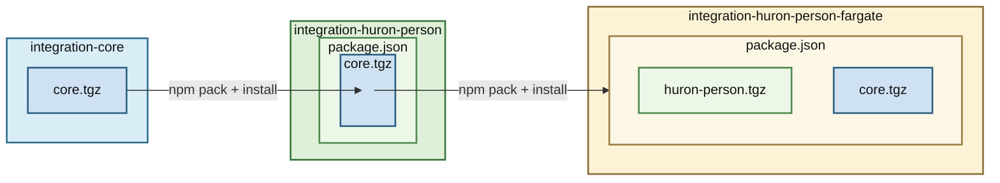

# integration-workspace-skills (BU → Huron person integration)

Shared Copilot skills repository for the BU → Huron person integration workspace.

## Purpose

This repository stores reusable skills that apply across multiple independent package repositories in this workspace.

The package repositories remain independently versioned and deployed:
- `integration-core`
- `integration-huron-person`
- `integration-huron-person-fargate`

### Overview of Repository Relationships:
- `integration-core`: Foundational utilities and shared logic for integration work. This comprises mainly interfaces and general use code for basic operations like S3 access, API clients, hash-based delta calculation, etc.
- `integration-huron-person`: Implements the core synchronization logic for Boston University → Huron person records. This comprises the main data mapping, and specific source/target business logic.
- `integration-huron-person-fargate`: AWS CDK infrastructure and serverless implementation for deploying the `integration-huron-person` project. This orchestrates a three-phase streaming delta synchronization pipeline using Lambda, ECS Fargate, S3, and SQS. Also primary among the orchestration is the implementation of parallel processing to speed up both the data acquistion from BU, and the pushing of mapped records into Huron.




## Layout

```text
integration-workspace-skills/
  .claude/
    skills/
      <skill-name>/
        SKILL.md
```

Skills live in `.claude/skills/`, a standard project skill location that both VS Code (GitHub Copilot) and Claude Code discover natively. No `chat.agentSkillsLocations` setting is needed.

## VS Code Setup (multi-root `.code-workspace`)

VS Code discovers project skills in `.claude/skills/` (as well as `.github/skills/` and `.agents/skills/`) at the top of **each root folder** of a [**multi-root**](https://code.visualstudio.com/docs/editing/workspaces/workspaces#_multiroot-workspaces) workspace. Skills found in any root are available to chat for the whole workspace, regardless of which project you are working in.

To make these skills available, add this repository as a root folder in your `.code-workspace` file (see the examples below). Nothing else is required.

Notes:
- Skills are only available while `integration-workspace-skills` is a root folder of the open workspace. Include it in every `.code-workspace` file for this integration.
- Do not add same-named skills to the package repositories. When roots contain duplicate skill names, only the primary root's copy is used.
- GitHub Copilot CLI and the GitHub Copilot app do not use VS Code workspaces. They discover project skills only in the repository they are started in.

See [Use Agent Skills in VS Code](https://code.visualstudio.com/docs/agent-customization/agent-skills).

## Claude Code Setup (started in the workspace root)

Claude Code has no multi-root workspace. A session starting in the workspace root directory (the directory that contains `integration-workspace-skills/` and the package repositories) loads `.claude/skills/` from that directory and its parents, but skills in subdirectories such as `integration-workspace-skills/.claude/skills/` are only loaded after Claude first reads or edits a file in that subdirectory.

To load the skills at startup, add this repository as an additional directory:

```bash
cd <workspace-root>
claude --add-dir integration-workspace-skills
```

Or, from within a running session:

```text
/add-dir integration-workspace-skills
```

Notes:
- `permissions.additionalDirectories` in `settings.json` only grants file access. It does not load skills, so use `--add-dir` or `/add-dir`.
- The same approach works when starting Claude Code inside a package repository, e.g. `claude --add-dir ../integration-workspace-skills` from `integration-huron-person-fargate/`.
- Claude Code cloud sessions do not have access to this local repository. They only load skills committed to the checked-out repository or enabled on your claude.ai account.

See [Extend Claude with skills](https://code.claude.com/docs/en/skills).

## Example Workspace: Core Only

```json
{
  "folders": [
    {
      "path": "integration-workspace-skills",
      "name": "skills"
    },
    {
      "path": ".copilot/memories",
      "name": "workspace-memories"
    },
    {
      "path": "integration-core",
      "name": "core"
    }
  ],
  "settings": {
    "chat.tools.terminal.autoApprove": {
      "npm test": true
    }
  }
}
```

## Example Workspace: Core + Person + Fargate

```json
{
  "folders": [
    {
      "path": "integration-workspace-skills",
      "name": "skills"
    },
    {
      "path": ".copilot/memories",
      "name": "workspace-memories"
    },
    {
      "path": "integration-core",
      "name": "core"
    },
    {
      "path": "integration-huron-person",
      "name": "huron-person"
    },
    {
      "path": "integration-huron-person-fargate",
      "name": "huron-person-fargate"
    }
  ],
  "settings": {
    "chat.tools.terminal.autoApprove": {
      "npm test": true
    }
  }
}
```

## Workspace-Scoped Memory Files

The `.copilot/memories/` directory (displayed as "workspace-memories" in the workspace) stores workspace-scoped Copilot memory files that apply to all integration projects.

**Purpose**: Contains coding preferences, task verification protocols, and workflow requirements that should be consistently applied across all projects (core, huron-person, fargate, dashboard, file-drop, etc.).

**Key file**: `task-verification-protocol.md` - Defines requirements for build verification, test execution, and completion reporting on all code implementation tasks.

**Discovery**: VS Code Copilot automatically loads memory files from this directory when included as a workspace folder in your `.code-workspace` file.

**Location**: The `.copilot/memories/` directory exists at the workspace root level (parallel to project folders), not within individual project repositories. This ensures workspace-wide conventions are version-controlled separately from project-specific code.

**Scope**: These memory files complement (not replace) the skills in this repository. Skills define domain-specific technical patterns, while memory files define workflow and verification requirements.

## Maintenance Rules

1. Keep each skill in its own folder with `SKILL.md` under `.claude/skills/`.
2. Use one canonical skill location path in docs and examples.
3. Document major skill changes in this repo history.
4. Do not assume workspace-level source control for package repos.
