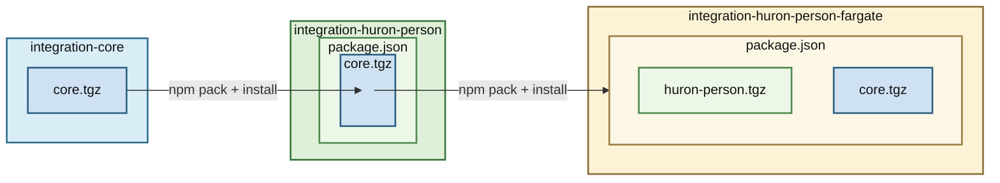

# integration-skills (BU → Huron person integration)

Shared Copilot skills repository for the BU → Huron person integration workspace.

## Purpose

This repository stores reusable skills that apply across multiple independent package repositories in this workspace.

The package repositories remain independently versioned and deployed:
- `integration-core`
- `integration-huron-person`
- `integration-huron-person-fargate`

### Overview of Repository Relationships:
- `integration-core`: Foundational utilities and shared logic for integration work. This comprises mainly interfaces and general use code for basic operations like S3 access, API clients, hash-based delta calculation, etc.
- `integration-huron-person`: Implements the core synchronization logic for Boston University → Huron person records. This comprises the main data mapping, and specific source/target business logic.
- `integration-huron-person-fargate`: AWS CDK infrastructure and serverless implementation for deploying the `integration-huron-person` project. This orchestrates a three-phase streaming delta synchronization pipeline using Lambda, ECS Fargate, S3, and SQS. Also primary among the orchestration is the implementation of parallel processing to speed up both the data acquistion from BU, and the pushing of mapped records into Huron.




## Layout

This repository is cloned **as the `.claude` directory of the workspace root**, so each skill ends up at `<workspace root>/.claude/skills/<skill-name>/SKILL.md`. That is a native project skill location that both VS Code (GitHub Copilot) and Claude Code discover without custom settings.

Repository layout:

```text
integration-skills/
  README.md
  skills/
    <skill-name>/
      SKILL.md
```

Workspace layout after cloning:

```text
<workspace root>/
  .claude/                  <- this repository
    skills/
      <skill-name>/
        SKILL.md
  .copilot/memories/
  integration-core/
  integration-huron-person/
  integration-huron-person-fargate/
  ...
```

Skills must stay directly under `skills/` in this repository. Do not add a `.claude/` directory inside the repository.

## Installation

```bash
cd <workspace root>
git clone https://github.com/whennemuth/integration-skills.git .claude
```

`git clone` fails if `<workspace root>/.claude` already exists and is not empty (for example, Claude Code may already have created `.claude/settings.local.json`). In that case, initialize the repository in place:

```bash
cd <workspace root>/.claude
git init
git remote add origin https://github.com/whennemuth/integration-skills.git
git fetch origin
git checkout -t origin/master
```

Claude Code's personal `settings.local.json` is ignored by this repository's `.gitignore`.

## VS Code Setup (multi-root `.code-workspace`)

VS Code discovers project skills in `.claude/skills/` only at the top of each **root folder** of a [**multi-root**](https://code.visualstudio.com/docs/editing/workspaces/workspaces#_multiroot-workspaces) workspace. Skills found in any root are available to chat across the whole workspace.

Because the skills live in the workspace root rather than in a package repository, add the workspace root itself as a root folder of your `.code-workspace` file (which is saved in the workspace root):

```json
{
  "folders": [
    { "path": ".", "name": "workspace" },
    { "path": ".copilot/memories", "name": "workspace-memories" },
    { "path": "integration-core", "name": "core" },
    { "path": "integration-huron-person", "name": "huron-person" },
    { "path": "integration-huron-person-fargate", "name": "huron-person-fargate" }
  ],
  "settings": {
    "chat.tools.terminal.autoApprove": {
      "npm test": true
    }
  }
}
```

The `workspace` root also contains every package folder, so hide them inside that root to avoid listing each repository twice in the Explorer and search results. Create `<workspace root>/.vscode/settings.json`:

```json
{
  "files.exclude": {
    ".copilot": true,
    "integration-*": true,
    "basic-readonly-npm-registry": true
  }
}
```

Folder-level settings apply only to their own root folder, so this hides the package folders in the `workspace` root without affecting their own roots. Each package repository keeps its own `.vscode/launch.json`, which VS Code only reads when the repository is a root folder.

Notes:
- Do not open the workspace root as a single folder (File > Open Folder). Discovery would still work, but VS Code ignores the `.vscode/launch.json` files of nested package repositories.
- Do not add same-named skills to the package repositories. When roots contain duplicate skill names, only the primary root's copy is used.
- GitHub Copilot CLI and the GitHub Copilot app do not use VS Code workspaces. They discover project skills only in the directory or repository they are started in.

See [Use Agent Skills in VS Code](https://code.visualstudio.com/docs/agent-customization/agent-skills).

## Claude Code Setup (started in the workspace root)

Claude Code loads project skills from `.claude/skills/` in the directory where it starts, so no extra configuration is needed:

```bash
cd <workspace root>
claude
```

Notes:
- When starting Claude Code inside a package repository, it stops searching parent directories at that repository's root. Add the workspace root with `--add-dir` (or `/add-dir` in a running session) to load the skills, e.g. `claude --add-dir ..` from `integration-huron-person-fargate/`.
- `permissions.additionalDirectories` in `settings.json` only grants file access. It does not load skills.
- Claude Code cloud sessions do not have access to this local clone. They only load skills committed to the checked-out repository or enabled on your claude.ai account.

See [Extend Claude with skills](https://code.claude.com/docs/en/skills).

## Workspace-Scoped Memory Files

The `.copilot/memories/` directory (displayed as "workspace-memories" in the workspace) stores workspace-scoped Copilot memory files that apply to all integration projects.

**Purpose**: Contains coding preferences, task verification protocols, and workflow requirements that should be consistently applied across all projects (core, huron-person, fargate, dashboard, file-drop, etc.).

**Key file**: `task-verification-protocol.md` - Defines requirements for build verification, test execution, and completion reporting on all code implementation tasks.

**Discovery**: VS Code Copilot automatically loads memory files from this directory when included as a workspace folder in your `.code-workspace` file.

**Location**: The `.copilot/memories/` directory exists at the workspace root level (parallel to project folders), not within individual project repositories. This ensures workspace-wide conventions are version-controlled separately from project-specific code.

**Scope**: These memory files complement (not replace) the skills in this repository. Skills define domain-specific technical patterns, while memory files define workflow and verification requirements.

## Maintenance Rules

1. Keep each skill in its own folder with `SKILL.md` directly under `skills/`.
2. Use one canonical skill location path in docs and examples.
3. Document major skill changes in this repo history.
4. Do not assume workspace-level source control for package repos.
